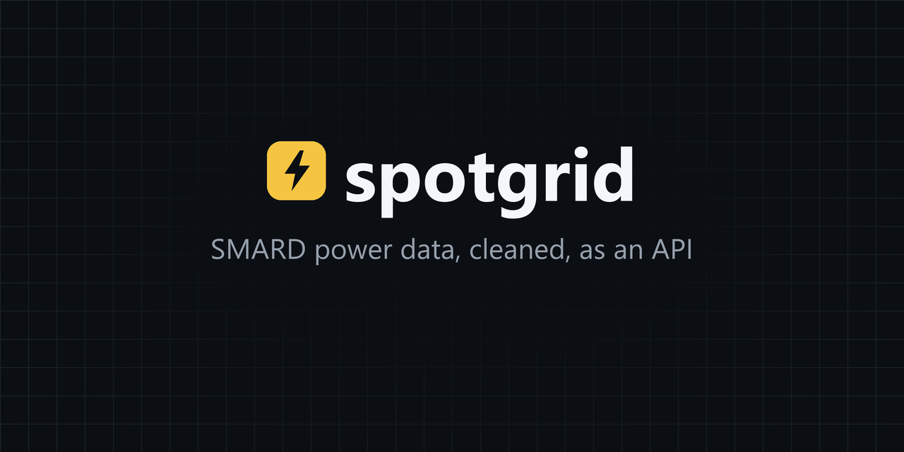
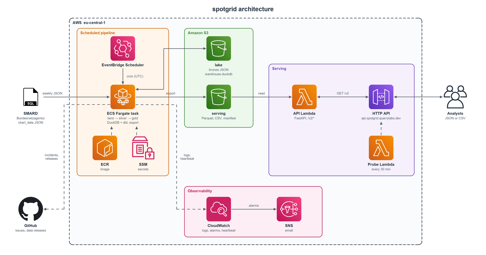

# spotgrid-lakehouse



Clean, analysis-ready German and neighbouring power-market data from SMARD, behind one simple API.

[](https://github.com/varunhs306/spotgrid-lakehouse/actions/workflows/ci.yml)

## Medallion layers

- **Bronze:** raw SMARD JSON, 15-min and hourly, for 9 grid regions (DE, its 4 TSOs, AT, LU, APG,
  Creos) and 14 bidding zones.
- **Silver:** DuckDB merge, one row per series, area and slot; revisions logged, bad rows quarantined.
- **Gold:** dbt models per area and slot, with derived features and daily/monthly aggregates.
- **Serving:** Parquet and CSV on S3, read by a Lambda API; the warehouse is never queried.

### Transformations from source

Values are not modified; units stay MWh and EUR/MWh, gaps are not filled.

| | SMARD | spotgrid |
|---|---|---|
| Layout | One file per series, area and week: `[epoch_ms, value]` | Wide table, one row per area and slot |
| Time | Epoch ms | `ts_utc` and Europe/Berlin `local_date` (23/25-hour DST days) |
| DE price | DE-AT-LU to 2018-09-30, then DE-LU | One DE-LU series; `source_zone` keeps the origin |
| Validation | — | Out-of-range, misaligned and malformed rows quarantined |
| Revisions | Overwritten in place | Logged with old value, new value and detection time |
| Derived | — | Forecast error, renewable share, net pumped storage, spread to DE-LU, `is_complete` |
| Aggregates | — | Day and month: energy sums, base/peak/off-peak, negative hours |

## Architecture



Runs on AWS in eu-central-1: EventBridge Scheduler starts a Fargate task in the morning, every
30 minutes in the afternoon while tomorrow's prices are due, and in the evening. The warehouse is a
DuckDB file in S3.

## API

<https://api.spotgrid.quarrylabs.dev/docs>

| Endpoint | Returns |
|---|---|
| `/v2/grid` | Load, generation by source, forecasts and features per region |
| `/v2/prices` | Day-ahead prices per zone with the spread to DE-LU; base, peak and off-peak per day or month |
| `/v2/revisions` | Every change SMARD made to a published value |
| `/v2/catalog` | Series, regions, zones, coverage and freshness |
| `/v2/bulk` | Download links for whole months as CSV |

`region` or `zone` (comma-separated), `resolution=15min|hour|day|month`, `start` and `end` (local
dates in Europe/Berlin), `fields`, `format=json|csv`.

Monthly [data snapshots](https://github.com/varunhs306/spotgrid-lakehouse/releases)

## Run locally

```sh
uv sync
uv run pytest
BRONZE=./bronze LAKE=./lake SERVING=./serving uv run python -m spotgrid_lakehouse.pipeline run
```

## Contributing

Issues and pull requests are welcome: bugs, wrong or missing data, new series or features.

1. Open an issue first for anything larger than a fix, so we agree on the approach.
2. Fork, branch from `main`, and keep the change focused.
3. Before pushing: `uv run ruff format`, `uv run ruff check` and `uv run pytest` must pass.
4. Open the PR against `main` with what changed and why; CI runs the same checks.

A new SMARD series or region goes in `src/spotgrid_lakehouse/sources/catalog.py`; landing, silver,
dbt and the API follow from it.

## Data

Bundesnetzagentur | SMARD.de, licensed under
[CC BY 4.0](https://creativecommons.org/licenses/by/4.0/). The tables and the API aggregate the
published values and derive new ones (such as forecast errors). Provided as is, without warranty of
correctness or completeness.
